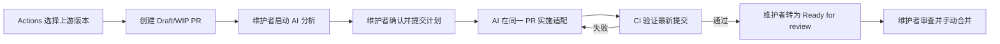

# 上游版本选择性同步

本机制通过 GitHub Actions 评估 [QuantumNous/new-api](https://github.com/QuantumNous/new-api) 的版本变化，创建一个 Draft/WIP Pull Request 作为整批工作的入口。维护者在自己的编码代理会话中让 AI 接管该 PR：先分析，确认计划后再实施；代码、处理计划、来源和版本记录都留在同一个 PR。CI 负责验证，最终由维护者审查并合并。没有平台页面，也不在 CI 中调用 AI 模型或配置 AI 密钥。



## 来源与版本语义

- 初始 fork 始终是 `v1.0.0-rc.26` / `8f6961c675932f406260ff0c218bc2aa0603e9b2`，见 [UPSTREAM.md](../UPSTREAM.md)。评估更高版本或迁入部分功能不会覆盖这个历史事实。
- 上游 tag 固定到完整 SHA；tag 移动时旧计划失效。上游仓库固定为 QuantumNous/new-api。
- 目标版本代表评估范围。选择性同步不等于已经完整升级到该版本；不采用、暂缓和部分迁移项须保留。
- 下游 `VERSION` 延续 `v1.0.0-rc.26-novamaas.N`。实际实施批次增加修订号；单纯分析不改版本，同批次修复不重复升级。

## 使用前准备

先将同步工具和工作流合入默认分支，再从默认分支手动运行。仓库 **Settings → Actions → General → Workflow permissions** 需要允许 Actions 创建 PR。GitHub 将创建和批准 PR 绑定在同一设置中；本实现只创建草稿 PR，不批准、不自动合并。默认令牌只读，创建 PR 的独立 job 才申请写权限。

AI 使用维护者本地的 Codex 或其他编码代理，由维护者主动交付 PR 地址和阶段任务。CI 不会在描述中出现某条指令后自行唤醒 AI。AI 应使用维护者正常的 GitHub 身份提交和 push；由 `GITHUB_TOKEN` 创建的初始 PR 不保证触发后续 PR 工作流，第一次人工/AI 正常 push 后会验证当前 HEAD。

## 第一步：CI 创建 WIP PR

在 **Actions → Upstream sync · Assess version → Run workflow** 输入：

| 参数 | 含义 |
| --- | --- |
| `target` | 已存在的上游 tag，例如 `v1.0.0-rc.44` |
| `range_base` | 已评估范围的起点 SHA，第一次保持初始 fork 默认值 |
| `batch` | 唯一批次名，使用小写字母、数字和连字符 |
| `next_version` | 实施后使用的下游版本，例如 `v1.0.0-rc.26-novamaas.3` |

CI 读取固定范围内的提交、文件变化、下游重叠、历史记录和补丁等价证据，生成：

```text
docs/upstream-sync/plans/<batch>/plan.json
docs/upstream-sync/plans/<batch>/report.md
docs/upstream-sync/plans/<batch>/AI_HANDOFF.md
```

PR 使用 `codex/upstream-plan-*` 分支和仓库模板，包含进度清单与 AI 接管说明。这个 PR 从计划一直使用到实施完成，不需要另建实施 PR。仅有计划时必须保留 Draft；提前转为 Ready for review 会被同步校验拒绝。

`report.md` 最初是机械差异证据，不是 AI 分析。每个上游提交默认形成候选项；文件不冲突或补丁等价都不能代替行为兼容判断。后续批次缩小范围时，历史中的暂缓、不采用和部分迁移项仍会带入后续跟进。

## 第二步：让 AI 分析，在 PR 中持续更新

打开 PR 的 `AI_HANDOFF.md`，复制“第一步”的提示词，替换实际 PR 地址，交给自己的 AI 编码代理。也可以这样开始：

> 请接手这个上游同步 PR，按其中 AI_HANDOFF.md 的第一阶段分析差异并更新建议，保持 decision=pending，暂不修改业务代码，等待我确认。

AI 读取本地与上游实现、依赖修复和测试，按功能说明：

- 上游新增或改变了什么，本仓库是否已有对应实现。
- 建议采用、迁移、协同升级、不采用、暂缓或判定已覆盖的理由。
- 对协议、计费、权限、数据兼容和下游扩展的风险，以及需要保留的行为。
- 建议修改的精确源码和回归测试路径、依赖与固定来源证据。

建议保存在每项 `ai_analysis` 和报告中；`decision` 等人工确认字段保持待定。AI 在同一分支正常提交，并更新 PR 描述中的“已分析／待选择”进度。维护者仍需判断业务语义；AI 建议本身不授权实施。

## 第三步：确认处理计划

维护者在同一 PR 分支确认各项 `decision`、`reason`、`feature`、`dependencies` 以及必要的 `evidence`：

| decision | 含义 |
| --- | --- |
| `pending` | 尚未确认，有此项就不能实施 |
| `merge` | 计划完整采用该来源变更 |
| `migrate` | 迁入明确的部分行为，并保留下游适配 |
| `upgrade` | 采用属于协同升级的变更，显式指定依赖 |
| `skip` | 本批次不采用，说明理由 |
| `defer` | 暂缓，说明阻塞与跟进条件 |
| `covered` | 已有等价实现，提供代码或测试证据 |

所有采用项还需给出人工确认的精确文件范围，包含允许新增的测试文件：

```json
"ai_scope": {
  "paths": ["service/example.go", "service/example_test.go"],
  "instructions": "迁入已选择的功能，保留当前下游行为并补充回归测试。"
}
```

不能使用目录、通配符或受保护路径。`merge` / `upgrade` 使用 `selected_scope=full_commit`、`patch=null`；交由 AI 适配的 `migrate` 使用 `selected_scope=ai_adaptation`、`patch=null`，并在 `evidence` 说明要迁入的范围。依赖须已选择或已有覆盖证据，AI 不能悄悄扩大范围。只有不采用、暂缓或已覆盖项时，不产生应用版本升级。

把确认的计划提交到当前 PR，记录完整提交 SHA，作为 `APPROVAL_COMMIT`，然后明确授权 AI 实施。工具将计划内容指纹、来源和该提交绑定；计划确认以前不能夹带业务代码。这个 SHA 是维护者确认的证据锚点，CI 不替代用户对 AI 会话的授权。

## 第四步：AI 在同一 PR 实施，CI 验证

复制 `AI_HANDOFF.md` 的实施提示词，提供实际 PR 地址和 `APPROVAL_COMMIT`。AI 只修改已选项批准的源码和测试，适配冲突，正常追加提交；不 rebase、不 force push。

正常提交代码后，在当前 `codex/upstream-plan-*` 分支执行：

```bash
python3 .github/scripts/upstream_sync_handoff.py finalize \
  --repo . \
  --plan docs/upstream-sync/plans/<batch>/plan.json \
  --approval-commit <完整确认提交SHA>
```

工具重新核验固定上游、审批计划、依赖、修改范围和身份署名，生成并提交 `UPSTREAM.md`、`VERSION` 和 `docs/upstream-sync/history/<batch>.json`。历史包含选定来源及批准范围、实际代码树和补丁指纹。其状态是 `ready_for_ci`，不会把尚未发生的 CI 写成通过。

正常 push 后，PR 工作流从默认分支读取可信工具，核验本次事件的精确 HEAD 与来源记录，再运行七项检查：前端类型、测试、生产构建，根 Go 测试和构建，以及 `relaykit` 在 `GOWORK=off` 下的独立测试和构建。验证不持有仓库写凭据，不使用生产连接；本地接管不启动 Docker。

如果失败，AI 在批准范围内修复并提交，再次执行 `finalize`、push 和等待 CI。工具接受追加修复，更新同批次记录的 revision，不重复增加产品版本。任何来源代码修复都使旧记录失效，必须重新记录并验证最新 HEAD。

发现批准范围不足时，AI 说明缺少的依赖或路径，等待维护者重新决策。当前实现要求确认提交之前只有计划材料：需通过正常追加的回退提交恢复到固定基线的业务代码及元数据，再提交和确认新计划，重新实施；也可以关闭当前批次并基于新 main 创建新批次。不要把已实施代码伪装成“确认前已有代码”，也不要改写历史。main 已前进时，同样需更新分支、重新评估和确认当前基线。

工作流、同步工具、策略、许可证、身份署名、README 与来源治理文件均不属于自动适配范围；来源和版本文件只由工具生成。需要这些文件的治理调整时，另走维护者审查的专门 PR。业务回归测试应按 AGENTS.md 覆盖相关边界；通用 CI 通过不能证明所有数据库或计费语义都等价。

## 第五步：转为待审并手动合并

AI 更新同一个 PR 的处理结果、审批 SHA、验证链接、剩余风险及已完成清单，保留模板结构和人工确认项。每次重新 push 后都以最新 HEAD 的检查结果为准。

维护者核对选定范围、下游行为、来源和版本语义及业务验证。形成长期核心运行时差异时，按 [README 台账规则](../README.md#novamaas-与上游差异) 决定并维护真实 PR 记录；CI 不自动创建台账条目或取代该判断。

检查通过后，维护者可以点击 **Ready for review**，或明确授权 AI 执行 `gh pr ready` 并移除标题中的 WIP。**Ready for review 表示可审查，不代表已经合并。** 最终由维护者审查并操作合并；AI 和工作流不运行自动合并，也不直接推送 main。合并后沿用本仓库既有发布流程。

## 可选：确定性补丁执行方式

原有 **Upstream sync · Apply plan** 仍可用于已经人工准备并审查好补丁的计划，不调用 AI。它从固定下游基线执行 `merge` / `upgrade` 的 cherry-pick，`migrate` 则要求 `selected_scope=reviewed_patch`、`patch.path` 和 `patch.sha256`。补丁保存在 `docs/upstream-sync/patches/`，可用 `shasum -a 256` 计算指纹。

此兼容路径在隔离工作区验证成功后另建实施草稿 PR，届时关闭原评估 PR，避免重复合入。带有 `ai_adaptation` 的计划应使用上面的同 PR 接管方式。

## 本地检查工具

工具仅依赖 Python 3 标准库，不需要启动业务服务：

```bash
python3 -m unittest discover -s .github/scripts -p 'test_upstream_sync*.py' -v
python3 .github/scripts/upstream_sync_handoff.py --help
python3 .github/scripts/upstream_sync.py --help
```

本地 `analyze` 前需获取目标上游对象；具体参数以对应子命令的 `--help` 为准。撤销已合入的同步使用新的修复或 revert PR 保留历史；涉及数据和账务时按该变更的兼容方案处理。
