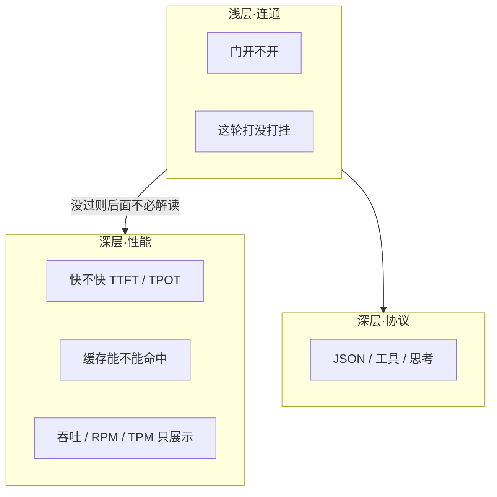
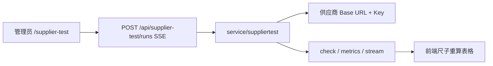

# 供应商自测工作台

文本测试对照《供应商自测指标说明（精简）》，检查上游 API 的连通、性能与协议。视频测试还支持通过本平台真实 API 入口联调素材引用、生成与火山官方产物验证。

## 三层在测什么

| 层 | 没过意味着 | 判定 |
|---|---|---|
| 浅层·连通 | 后面性能、协议都不必解读 | 检查项：通过 / 跳过 / 失败。压测错误率：正常 / 异常 |
| 深层·性能 | 能连，体验或成本可能不行 | 正常 / 偏慢 / 无法对照 |
| 深层·协议 | 多数厂商本来就没做 | 不接受或没有对应结构 → 跳过，不是供应商坏了 |

判定标准：延迟指标用 **正常 / 偏慢 / 无法对照**；连通性、错误率与命中率指标用 **正常 / 异常**。浅层连通未通过（如错误率异常）时，深层性能标记为“无法对照”，避免幸存者偏差。尺子可编辑，改完表格马上重算，不必重跑。

## 怎么跑（操作顺序，不是三个独立产品）

页面上仍是三个按钮，对应一次真实验收顺序：

1. **基础全量**（浅层检查 + 协议抽查）
2. **缓存**（约 3k 或更长语料原文，不垫字）
3. **压测**（冷路径勾选打断缓存；命中后体感不要勾）
4. 按该厂商改尺子

文本与视频的上游直测由测试器直接调用目标 URL。本平台视频联调使用生成令牌调用平台公开入口，沿用正常渠道路由、计费与 relay 日志。测试器不另建扣费或结算流程。

## 代码落点

| 层 | 路径 |
|---|---|
| 页面 | `web/src/features/supplier-test/` |
| 尺子与三档判定 | `baselines.ts`（默认宽松 / 较严，可改） |
| 语料 | `corpora/`，名称后的 token 数为估算 |
| SSE 入口 | `controller/supplier_probe.go` → `POST /api/supplier-test/runs` |
| 真正发请求 | `service/suppliertest/runner.go` |
| 厂商请求/解析适配 | `vendor.go`、`client.go`，说明见 [SUPPLIER_TEST_VENDORS.zh_CN.md](./SUPPLIER_TEST_VENDORS.zh_CN.md) |
| 导出报告 | `report.ts`，按三层排 |

## 和指标说明对齐的约定

- 空温度、`top_p` 不发送。
- 缺字段、厂商没做的协议：默认 **跳过**。下拉选了 GLM / Kimi / DeepSeek 后，文档要求有的字段没有则失败。请求键名与响应别名见 [SUPPLIER_TEST_VENDORS.zh_CN.md](./SUPPLIER_TEST_VENDORS.zh_CN.md)。
- 连通失败后，流式 / usage / request id / 采样改为跳过（无法对照），不再记成失败。
- 基础验收里，只有勾了流式的连通性才展示模型正文。
- 缓存预热发送选中语料原文，不填充到 N token。
- 压测可走缓存 = 每枪同一语料；打断缓存 = 语料前加随机前缀。
- 缓存命中率、TTL 是否达标只看页面尺子，后端检查项只负责有没有拿到 `cached_tokens`。
- RPM / TPM 是这轮短测推算，不是厂商上限。
- Max tokens 只限制输出长度。

## 视频素材与证据报告

视频素材使用一个默认分组，上传时自动复用或创建，无需填写分组 ID，也不新增按测试划分的素材空间。可以直接添加多张 URL／Base64 图片，或选择已有平台素材；按首帧、首尾帧或多图参考场景配置用途和顺序。

完整测试提交视频后记录 Task ID，排队与执行中状态各记录首次返回，然后保留视频最终返回；接着使用单独配置的官方 AK/SK 验证生成的视频 URL 并记录结果。Secret 加密保存，无需下载或转存视频。

只出一份报告，包含两个连续章节：“视频生成”记录请求体、提交回执、Task ID、首次排队／执行中返回和最终视频返回；“官方产物验证”记录验证请求、QueryID、官方回执和最终结果。共用一条轮询汇总，不重复列出轮询，也不拆成两份导出。复用文本的品牌、A4 排版与打印逻辑，直接展开脱敏请求头及缩进后的请求／响应 JSON，长内容自然分页；不以固定页数压缩正文，Markdown、HTML 和 PDF 均包含完整两部分。

生成成功、官方来源命中、模型对照是三个独立结论。别名缺少可信映射时不猜测型号。仅查询已有 Task ID 会标明缺少原提交证据；超时不把最后一次运行中响应当成终态。

运行结束后按 Run ID 读取固定记录，修改表单不会改变旧报告。Base64 正文展示大小与哈希，完整原文通过受权限保护的附件下载；签名 URL 与凭据脱敏。补查已有 QueryID 不重复创建官方查询，也不重新生成视频。

接口、存储、官方限制与验收范围见[视频素材与报告改造说明](SUPPLIER_VIDEO_ASSET_TEST_PLAN.zh_CN.md)。

## 范围边界

文本测试不承担学科评测、配额打满或 tokenizer 审计。视频来源验证按火山官方返回的特征线索解释，不构成法律鉴定或权属认定。
